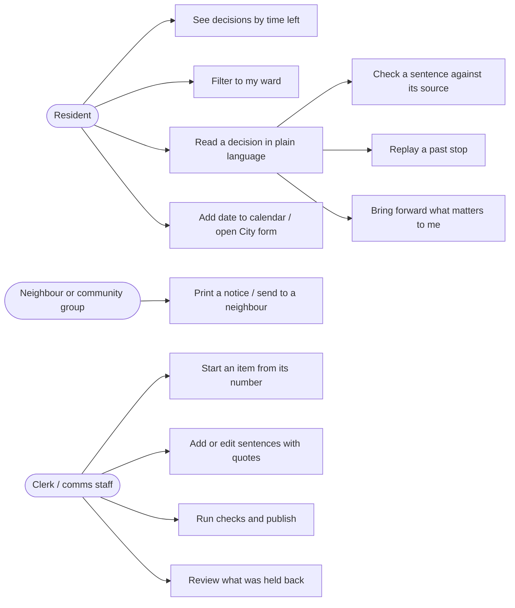
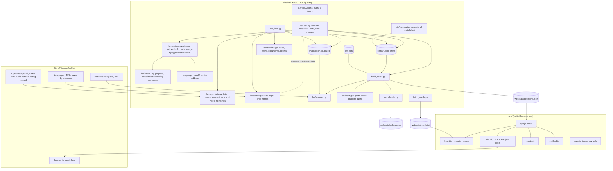
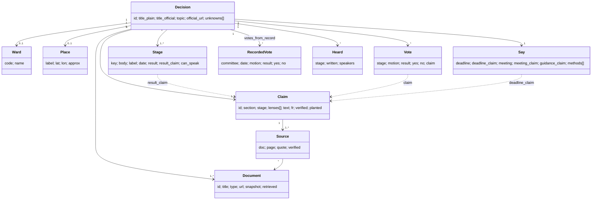
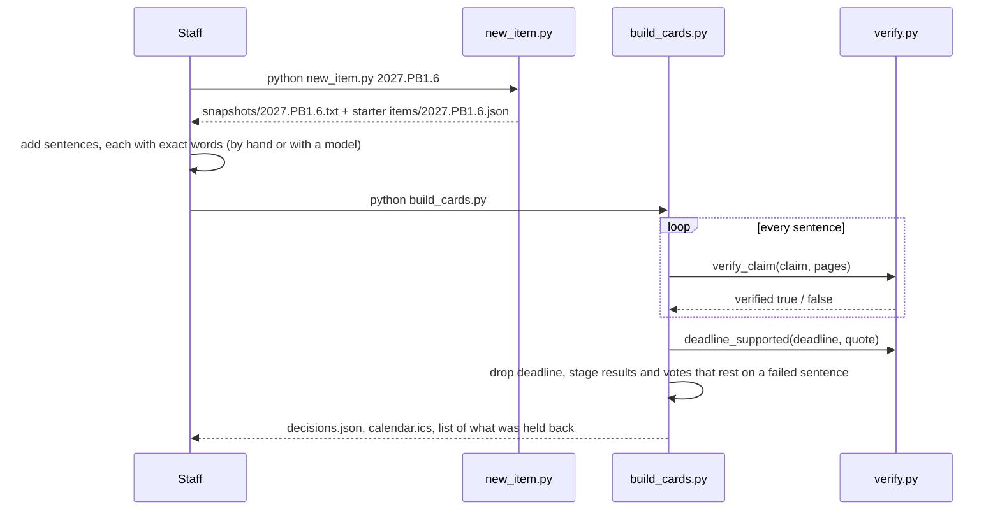

# Requirements, design and architecture

Diagrams are Mermaid; GitHub draws them. Keep them in step with the code.

## Requirements

Functional

| ID | The system shall | From the brief |
|---|---|---|
| F1 | show what is proposed and why in plain language | success criteria |
| F2 | show the ward and place of a decision, and let a resident filter to their own ward | "is this near me?" |
| F3 | show a deadline only when its date is written in the record; otherwise show the meeting date and say no deadline is posted | "do not infer a deadline" |
| F4 | link every sentence to the exact source words, the document, and the date it was copied | constraints |
| F5 | label each item as staff recommendation, committee recommendation or Council decision | constraints |
| F6 | show a stage result or a vote only when a checked sentence supports it | "worse than no summary" |
| F7 | let a resident see the item as it stood at each past stage | "follow a proposal through multiple meetings" |
| F8 | show counts of letters and speakers per stage, without names | "how public input was considered"; privacy |
| F9 | list what the record does not say | "preserve uncertainty" |
| F10 | give staff a list of every sentence with its check result | municipal users |
| F11 | offer a printable notice, a share text and a calendar feed | offline residents |
| F12 | create a starter item from an item number | municipal users |

Non-functional

| ID | Requirement |
|---|---|
| N1 | Privacy: no accounts, cookies, analytics or storage. Ward, location, lens and language live in memory and are gone when the tab closes. No map tiles are requested |
| N2 | Accuracy: the check uses no AI and has tests, including a real misleading record |
| N3 | Accessibility: WCAG 2.1 AA target; keyboard and screen-reader usable; phone-first |
| N4 | Neutral tone |
| N5 | Cost: free static hosting; checking needs only Python |
| N6 | Portability: a new city supplies `city.json`, item files and, ideally, a page reader for its agenda system |
| N7 | Explainable: no frameworks; every file short enough to walk through |

## Use cases

## Components

## Data sources

| Source | Read by | How | Kept | Left out |
|---|---|---|---|---|
| [Public notices](https://open.toronto.ca/dataset/public-notices/), City open data | `btv/opendata.py`, `btv/notices.py` | CKAN `package_show`, then `datastore_search` 1000 rows a page, 1 s pause, 60 s timeout, User-Agent naming the project | Title, date, notice words (as a dated snapshot), first address and its coordinates, application numbers, notice link | Contact person, signer |
| [Council voting record](https://open.toronto.ca/dataset/members-of-toronto-city-council-voting-record/), 2022 to 2026 term, City open data | `btv/opendata.py` | Same API, one query filtered to our agenda item numbers | Committee, date, motion type, the City's result words, yes and no counts | Every councillor's name, vote descriptions |
| Agenda item pages (secure.toronto.ca) | `btv/tmmis.py` | Only from pages a person saved in their own browser (`refresh.py --source tmmis --html-dir`). The site blocks automated downloads and we do not get around it | Stops, dates, ward, documents, counts of letters and speakers | Names of people who wrote in or spoke |
| [City Wards](https://open.toronto.ca/dataset/city-wards/), City open data | `fetch_wards.py` | Once, by hand | Simplified outlines in `web/data/wards.txt` | |

Everything in this table is read by fixed rules. No AI is used to fetch, choose, match, extract, check or write change notes.

## Data model (one decision card)

## Publishing a card

## Why this architecture

| Choice | Reason | Trade-off |
|---|---|---|
| Static site reading one JSON file | No server to attack, to pay for, or to log a resident's location. Any city IT team can host it. The site keeps working if the pipeline is down | Content changes only when staff rebuild. Agendas change on a publishing schedule, so this fits |
| Summaries prepared ahead, not a live chatbot | Every sentence can be checked and reviewed before a resident sees it. A chatbot can say something new and wrong to each visitor | No free-form questions |
| Draft by anyone, check by plain code | The drafter can be a model or a person and is never trusted. The check is about 80 lines with tests | It proves the words exist, not that the sentence reads them fairly. Human review stays |
| Dated text copies of the record | The check is repeatable; the reader sees when the record was copied; a re-copy shows what changed | Copies go stale until refreshed |
| Rules, not AI, for stops, ward, documents and counts | These are structured on the City's page. Same page in, same answer out | Tied to this page layout; a layout change needs a parser fix (the tests would catch it) |
| Our own SVG ward map | No map tiles, so no outside server learns where a resident is looking. Each ward is a real keyboard-reachable button | No street detail |
| No JavaScript framework or build step | A first-time reader can follow it; nothing to install; fast on old phones | More hand-written HTML strings; revisit past about ten screens |
| Local model option (Ollama) | Records and prompts stay on the City's computer; no API key | Smaller models draft worse; not yet tested |

## Scaling

| Dimension | Now | Path |
|---|---|---|
| Visitors | Static files on a CDN | No change needed |
| Items | One JSON file, fine into the low hundreds | One file per item plus a small index |
| Staff effort | Minutes per item to draft and review | Model drafts by default; staff review only what the check or a reviewer flags |
| Freshness | Built: a scheduled GitHub Actions job reads City open data every 3 hours, adds new notice cards, attaches recorded votes, notes what changed, hides sentences that stop matching, and republishes | Ask the City for agenda item numbers in the notices dataset; alert staff by e-mail when a sentence is hidden |
| Cities | Toronto reader in `tmmis.py` | One reader per agenda system (eSCRIBE, Legistar, CivicWeb) producing the same record shape; everything after that is shared |
| Languages | English, unreviewed French | Reviewed translations stored per sentence; quotes stay in the original language |

## Known limits

- The check passes a real quote attached to a misleading sentence. A person must still review.
- Agenda item pages cannot be downloaded automatically (the City blocks it). The three hand-made cards refresh only when a person saves their pages from a browser.
- Public notices in City open data carry no agenda item number. A notice is matched to another item only by a shared planning application number, and only when exactly one item has it. So a notice card does not show the later committee or Council decision, and its votes are not attached.
- Notice cards use the notice's first address. If the City's data places it outside the community council named in the notice (seen once: "411 Kennedy Avenue" for "Kennedy Road", Scarborough), the card shows no pin or ward rather than a wrong one.
- Deadline and meeting rules read English sentence patterns found in real notices. A notice worded differently gives no deadline (the card then shows "No date"), never a guessed one.
- Recorded votes come from the 2022 to 2026 term's voting record only. Items from the next term need the next resource name in `btv/opendata.py`.
- Hand-made cards: claim-backed vote counts and approximate place coordinates are typed by hand.
- Ward outlines are simplified; location-to-ward can be wrong near a boundary.
- Only item pages and one notice excerpt are used. Long staff reports (PDF) are linked but not yet summarised.
- `summarize.py` has never been run against a model.
